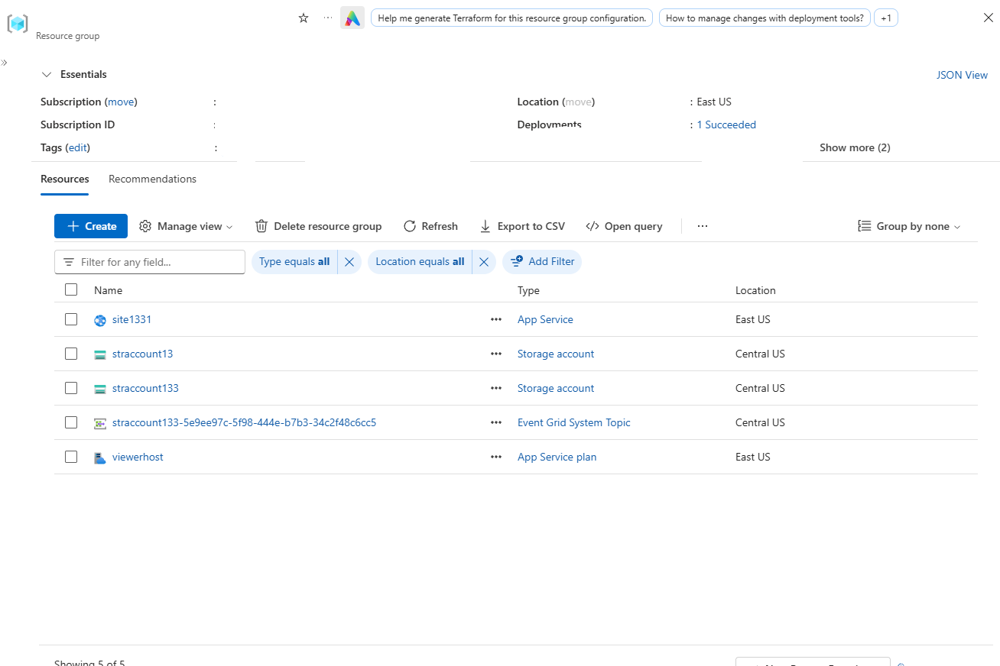
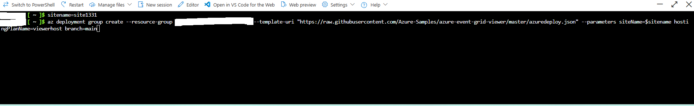
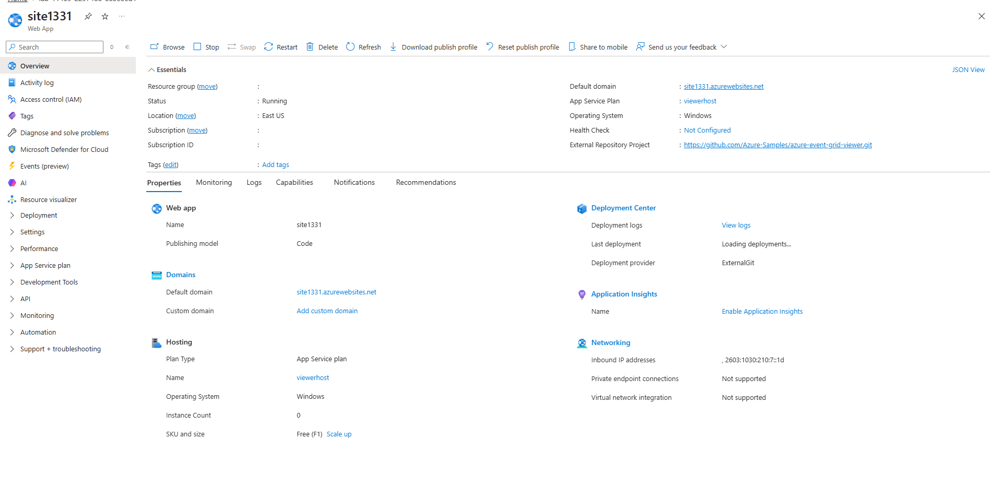
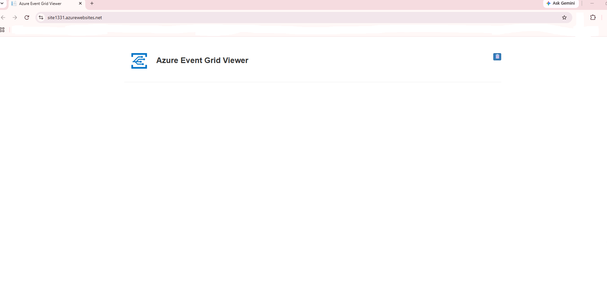
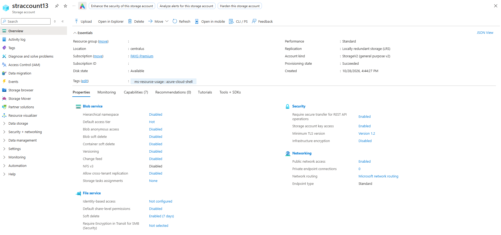
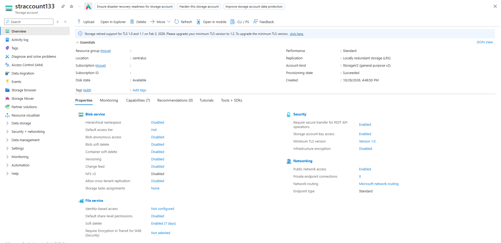
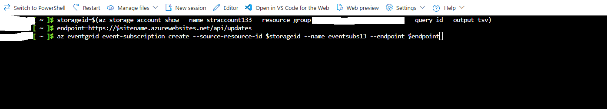
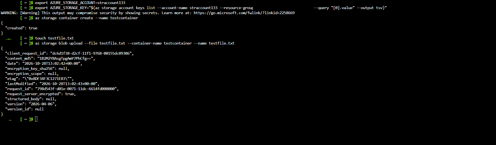
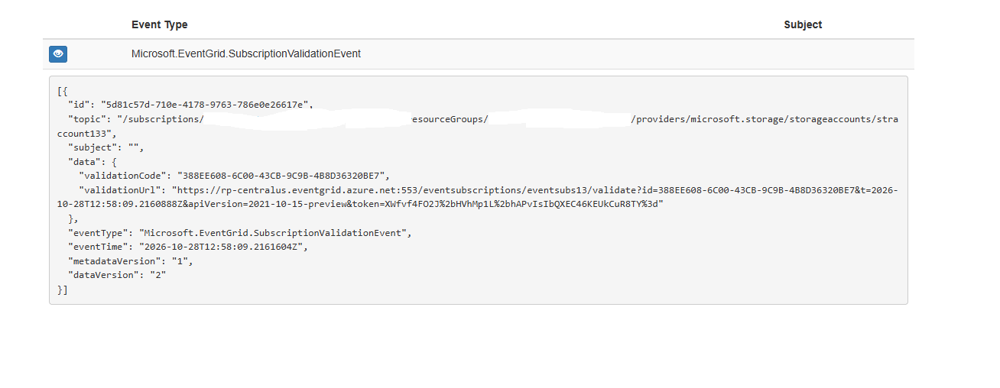
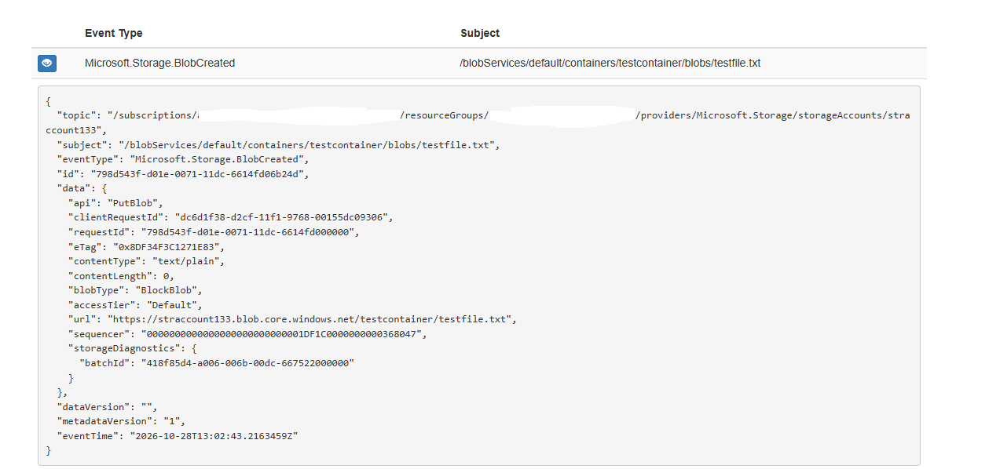

# Route Storage Events to Web Endpoint with Azure CLI

---

## 1. Architecture & Provisioned Resources

### Core Infrastructure Topology

| Resource Type | Resource Name | Specification / Purpose | Region / Location |
| :--- | :--- | :--- | :--- |
| **App Service** | `site1331` | Web application hosting the Azure Event Grid Viewer | East US |
| **App Service Plan** | `viewerhost` | Free (F1) App Service plan hosting the viewer site | East US |
| **Storage Account** | `straccount133` | General Purpose V2 storage (`Standard_LRS`) triggering blob events | Central US |
| **Event Grid System Topic** | `straccount133-5e9ee97c...` | System topic for storage account events | Central US |
| **Event Subscription** | `eventsubs13` | WebHook event subscription routing blob events to `/api/updates` | Global |

---

### Provisioned Environment Validation

*Resource group inventory confirming successful deployment of App Service, Storage Accounts, System Topic, and App Service Plan.*

---

## 2. Step-by-Step Implementation

### Step 1: Deploy Web Endpoint (Event Grid Viewer)

1. Deployed the Azure Event Grid Viewer web application using `az deployment group create` with a remote ARM template.
2. Verified successful creation of the Web App `site1331` and App Service plan `viewerhost`.

*Azure CLI command executing deployment group create to provision the Event Grid Viewer site.*

---

*App Service overview for site1331 confirming web app status and default domain.*

---

*Azure Event Grid Viewer web site interface loaded and ready to receive events.*

---

### Step 2: Provision Storage Account

1. Provisioned a General Purpose V2 storage account (`straccount133`) in the `centralus` region using `az storage account create`.
2. Verified storage account creation and configuration properties in the Azure Portal.

*Azure CLI command creating storage account straccount133 in Central US with Standard_LRS SKU.*

---

*Azure Portal overview for supporting storage account straccount13.*

---

*Azure Portal overview for target storage account straccount133.*

---

### Step 3: Create Event Subscription

1. Retrieved the resource ID of `straccount133` and configured the WebHook endpoint URL targeting `/api/updates`.
2. Created the Event Grid event subscription (`eventsubs13`) using `az eventgrid event-subscription create`.

*Azure CLI command creating event subscription eventsubs13 linking storage account events to WebHook endpoint.*

---

### Step 4: Trigger Storage Blob Events

1. Created a blob container named `testcontainer` within `straccount133`.
2. Uploaded a test file (`testfile.txt`) to the container using `az storage blob upload` to emit a `BlobCreated` event.

*Azure CLI commands creating storage container and uploading blob testfile.txt to trigger event.*

---

## 3. Verification & Monitoring

### Step 1: Verify Subscription Handshake Event

1. Accessed the live Event Grid Viewer application (`https://site1331.azurewebsites.net`).
2. Confirmed receipt of `Microsoft.EventGrid.SubscriptionValidationEvent` for `straccount133`.

*Event Grid Viewer displaying the subscription validation event payload generated during subscription creation.*

---

### Step 2: Verify Blob Creation Event Payload

1. Checked the Event Grid Viewer interface after uploading the blob file.
2. Verified receipt of `Microsoft.Storage.BlobCreated` event payload detailing the file path and upload properties.

*Azure Event Grid Viewer displaying the BlobCreated event payload for testfile.txt.*
